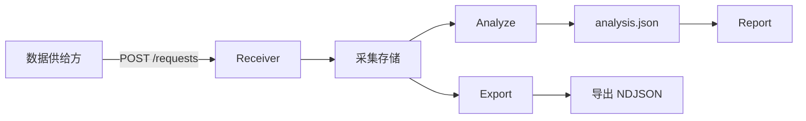
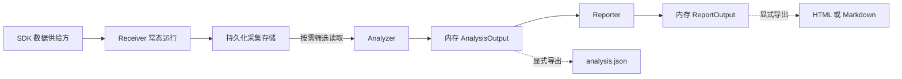

<!-- 本文件描述 actrail-kv 各命令的部署边界和数据流。 -->
# 部署架构

供给方按 [Receiver HTTP 协议](../reference/receiver/input.md)上报完整模型请求。[部署指南](../deployment/fullchain-deployment-guide.md)提供构建与接收验证步骤。

采用托管存储时，Receiver、Analyzer 与 Export 通过同一套[存储配置](storage/index.md)访问 SQLite 或分片 NDJSON。接收可以持续运行，分析、导出和生成报告可以按需或定时执行。

## 0.2.0 原生 SDK

新增[原生动态库与 Rust SDK](sdk/index.md)交付形态。HTTP 与 SDK 通过[公共采集服务](receiver/index.md)持续写入采集存储。analyzer 按需筛选读取存储，内存分析结果直接交给 reporter，分析结果和报告按需显式导出。现有 CLI 的文件生成、读取与部署行为保持不变。

