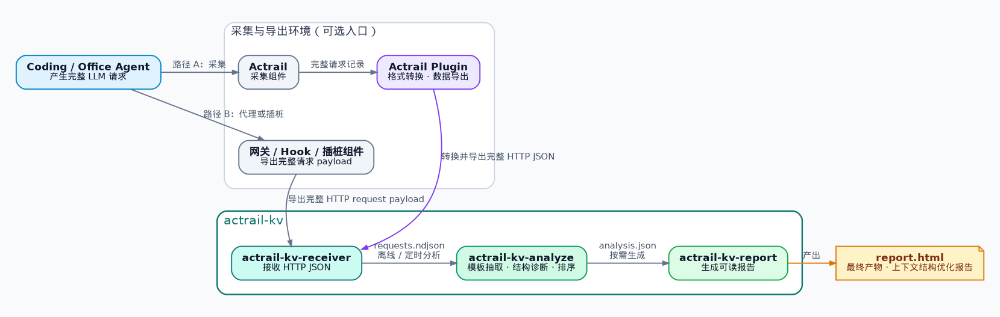

<!-- 本文件描述 actrail-kv 与外部采集组件的部署和数据交互关系。 -->
# 部署交互视图

观测组件、代理网关和其他数据供给方可以独立接入。它们负责将完整的 LLM 请求转换成 [Receiver HTTP 协议](receiver/input.md)。本仓库提供[自身的部署和接收验证步骤](../deployment/fullchain-deployment-guide.md)，供给方的配置按各自项目文档执行。

图展示单文件 NDJSON 部署。采用托管存储时，Receiver 与 Analyzer 通过同一套[存储配置](storage/index.md)访问 SQLite 或分片 NDJSON。Export 也可读取该存储。接收可以持续运行，分析和报告生成可以按需或定时执行。

可编辑源文件：[deployment-view.puml](assets/deployment-view.puml)。
