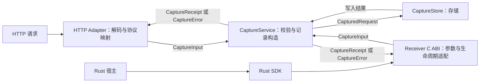

<!-- 本文件设计 0.2.0 的公共采集服务及 HTTP、SDK 输入通道。 -->
# Receiver 采集服务与通道

状态：0.2.0 待实现设计。需求见[版本目标](../../../dev/requirements/v0.2.0/target.md)。

## 模块边界

公共服务位于 `crates/receiver/src/service/`。公开接口、输入输出、配置入口和工厂位于 `crates/receiver/src/contracts/`。HTTP 适配器位于 `crates/receiver/src/channels/http/`，SDK 导出适配器位于 `crates/sdk/native/receiver/`。

依赖方向为通道到服务、服务到存储。公共服务不依赖 Axum、HTTP headers、动态加载器或 C ABI 类型。SDK 提交不经过 HTTP 适配器。

## 公共契约

| 契约 | 职责 |
| --- | --- |
| `CaptureInput` | 包含 `payload`、`source`、`session_key` 与 `comparison` 的通道无关输入 |
| `CaptureService` | 提供异步 `submit(input)`，等待存储操作完成 |
| `CaptureReceipt` | 返回服务生成的 `captured_at`，表示完整记录已交给后端并写入成功 |
| `CaptureError` | 区分输入字段错误、记录构造失败与存储失败 |
| `CaptureFactory` | 一次构造公共服务并返回其接口，封装内部装配 |

构造方式统一使用 Factory。已有存储接口 `CaptureStore` 作为依赖传入工厂，复用存储自身的契约和工厂，不新增镜像存储接口。B 当前没有独立配置项，不增加空配置类型。SDK 创建入口接收完整存储配置，调用存储工厂后将存储接口交给采集工厂。公共服务使用异步存储能力，原生 SDK 在内部桥接到同步 C ABI。

`CaptureInput` 是输入契约，`CapturedRequest` 是持久化记录，两者不混用。采集时间由服务生成，0.2.0 不增加调用方覆盖采集时间的能力。公开类型可在 crate 根重新导出，调用者只依赖公开契约。

## 数据映射与校验

| 公共输入字段 | HTTP 来源 | SDK 来源 | B 的业务规则 |
| --- | --- | --- | --- |
| `payload` | 请求体 JSON | 输入对象的 `payload` | 必须为 JSON object，保留完整内容 |
| `source` | `X-Actrail-Source` | `source` | 可缺省，保留原始字符串，不自动 trim |
| `session_key` | `X-Actrail-Session-Key` | `session_key` | 可缺省，提供时 trim 后不得为空 |
| `comparison.endpoint_key` | `X-Actrail-Endpoint-Key` | 对应字段 | 必填，trim 后不得为空 |
| `comparison.agent_key` | `X-Actrail-Agent-Key` | 对应字段 | 可缺省，提供时 trim 后不得为空 |
| `comparison.model_deployment_key` | `X-Actrail-Model-Deployment-Key` | 对应字段 | 可缺省，提供时 trim 后不得为空 |
| `comparison.kv_namespace` | `X-Actrail-Kv-Namespace` | 对应字段 | 可缺省，提供时 trim 后不得为空 |

输入元数据在进入 B 时保留缺失状态和原始文本，使必填与非空校验集中在 B。进入存储前再形成完整的 `ComparisonMetadata`。

A 负责请求体字节上限、JSON 语法解析、header 文本合法性与协议字段提取。B 负责 JSON 对象约束和业务字段校验。错误包含稳定类别和字段标识，HTTP 将其映射成现有状态码与响应文字，SDK 将其映射成公开错误。

HTTP 的语法错误与非对象输入继续返回 `400`，超限返回 `413`，存储失败返回 `500`，写入成功返回空响应体的 `202`。重构保持现有多重非法输入的校验优先级，避免改变对外错误行为。

A 按现有顺序解码 payload、source、session_key、endpoint_key 及其余元数据，在每一步调用 B 契约提供的纯字段校验函数。不能先解码全部 headers 再统一校验，否则非对象 payload 与非法 header 并存时会改变首个错误。校验函数和规范化规则只在 B 定义，SDK 输入转换使用同一组规则。适配器构造的已校验输入由公共契约封装，提交阶段直接构造记录，不重复执行同一组字段校验。

## 生命周期与写入语义

receiver 常态运行并持续写入采集存储。analyzer 使用独立实例按需筛选读取存储，receiver 的提交回执只表示写入结果。采集持久化不受分析或报告的显式导出操作控制。

1. CLI 解析 HTTP 及存储配置，通过工厂构造采集服务，再构造 Router 和监听器。
2. 原生 SDK 解析业务配置，打开存储并构造采集服务。该过程不创建 HTTP listener。
3. 两个通道均调用 `submit`。B 生成 UTC RFC3339 时间戳，构造记录并等待 `CaptureStore::append`。
4. 后端返回成功后，B 返回 `CaptureReceipt`。HTTP 保留现有空响应，SDK 返回 receipt。
5. 关闭 SDK 实例前完成在途调用，再停止其后台维护任务并释放存储。

后端写入成功不等于统一的断电持久性承诺。SQLite 与 NDJSON 沿用各自的事务和刷新保证。失败后的自动重试可能重复采集，SDK 不自动重试提交。

HTTP 继续使用宿主 CLI 的 Tokio runtime 和信号处理。SDK 的运行时由动态库实例管理，宿主无需提供 Tokio runtime。库不安装进程信号处理、不退出宿主进程、不初始化宿主全局日志配置。

## 配置与迁移

现有 `ReceiverConfig` 中的 HTTP 参数归 HTTP 通道使用。存储配置沿用所属模块定义，统一设置文件仍由 CLI 入口读取。SDK 接收内存配置，不执行 CLI 设置文件的缺项补齐与写回。

保留现有 `router`、`router_with_limit`、`router_with_storage` 入口，通过内部工厂转接公共服务。既有调用者可继续使用原入口，新实现逐步归入 `contracts/`、`service/` 和 `channels/http/`。

## 验证重点

用同一组业务输入分别构造 HTTP 请求与 SDK 调用，比较记录内容与错误类别。时间戳分别验证格式与生成时机，固定时间的服务测试可使用内部时钟替身。保留 HTTP 协议回归，增加直接提交、存储失败与关闭释放的集成验证。
