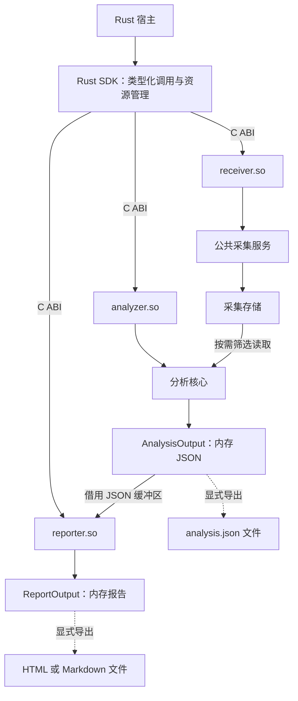

<!-- 本文件设计 0.2.0 原生动态库与 Rust SDK 的交付和模块边界。 -->
# 原生动态库与 Rust SDK

状态：0.2.0 已实现。目标是宿主编译一次，兼容动态库独立替换，重启宿主后生效。

## 交付结构

```text
crates/sdk/
├── native/
│   ├── contracts/ # 共享 C ABI 基础类型、版本与错误约定
│   ├── runtime/   # 公共 FFI 边界、线程执行、来源保护与原子导出
│   ├── receiver/  # libactrail_receiver.so，采集实例与直接提交
│   ├── analyzer/  # libactrail_analyzer.so，按需分析
│   └── reporter/  # libactrail_reporter.so，按需渲染
└── rust/          # 安全调用接口、动态加载与资源所有权
```

各叶目录为独立 Cargo package。三个业务动态库使用 `cdylib`。原生实现依赖对应核心库，Rust SDK 只依赖 ABI 基础契约、轻量数据契约和动态加载库。宿主的依赖图不包含 receiver、analyzer、reporter 核心实现。

Rust 调用层分别提供 `ReceiverFactory`、`AnalyzerFactory` 和 `ReporterFactory`。各工厂接收包含动态库路径、`base_dir`、可选配置文本和强类型字段覆盖的配置对象，一次完成加载与实例创建，返回对应能力接口。实例分别提供 `submit`、`analyze` 或 `render`，并提供消费实例的 `close`。输入和结果在 Rust 层类型化，跨 ABI 时统一转换为 JSON。

公开接口和构造入口放在各模块的 `contracts/` 下。Rust SDK 的接收、分析、报告能力分别位于 `src/receiver/`、`src/analyzer/` 和 `src/reporter/`，加载与公共错误归入内部共享模块。使用成熟的 `libloading` 管理原生加载，不自行实现 `dlopen` 封装。每个能力统一由 Factory 构造。

## 调用与依赖



三个库分别加载与创建实例。receiver 与 analyzer 通过持久化存储交接数据。analyzer 与 reporter 通过只读 JSON 缓冲区交接数据，所有权仍归原库，跨 ABI 不传递 Rust 内部对象。跨进程使用时可显式导出并读取文件。

## 能力与生命周期

| 能力 | 输入 | 输出 | 执行方式 |
| --- | --- | --- | --- |
| Receiver | 完整配置、统一采集输入 | 采集回执 | 常态运行，每次提交同步等待持久化写入 |
| Analyzer | 完整分析配置、存储来源和筛选条件 | 内存 `AnalysisOutput` | 按需筛选读取采集存储并分析 |
| Reporter | `AnalysisOutput`、报告格式与语言 | 内存 `ReportOutput` | 直接消费分析数据并渲染 |

SDK 的 `analyze` 返回分析结果，`render` 直接接收分析结果并返回报告内容。这两个方法均不自动写入产物文件，配置中的输出路径也不触发写入。分析核心的数据计算与文件发布需要分离，SDK 复用计算能力，CLI 继续执行现有计算、文件发布和文件读取流程。

`AnalysisOutput::export(path)` 显式导出既有 schema 的分析 JSON，`ReportOutput::export(path)` 显式导出 HTML 或 Markdown 正文，均沿用原子发布规则。SDK 的文件读取可作为独立便利入口，直接渲染路径不依赖该入口。语言按 reporter 实例配置或请求显式传入，不修改全局 locale 来影响其他实例。

## 内存产物交接

Rust SDK 的主要调用顺序为 `analyzer.analyze(selection)`、`reporter.render(&analysis, options)`。调用方按需执行分析结果或报告的 `export(path)`。receiver 保持独立运行并写入采集存储，提交回执不充当分析输入。

`AnalysisOutput` 持有 analyzer 返回的原始 JSON 响应缓冲区及原库所有权。reporter 的 C ABI 接受该完整成功响应和独立的渲染参数缓冲区，SDK 直接传递原响应的指针与长度，无需重编码完整分析结果。reporter 解析响应中的分析数据并执行渲染，借用在调用返回时结束。

`ReportOutput` 持有 reporter 返回的结果缓冲区及原库所有权。两种输出均可在业务实例关闭后继续读取或导出，原动态库保持加载直到相关输出释放。宿主可按需读取类型化视图，视图不替换用于交接的原始字节。这种方式省去文件中转及宿主侧重复序列化，reporter 内部仍需解析和校验 JSON。

格式缺省时 reporter 保留配置中的双格式语义，`ReportOutput` 可以包含 HTML 和 Markdown 两项。单格式输出直接 `export(path)`，多格式输出通过 `export_format(path, format)` 选择正文。分析和报告输出均携带来源保护信息，导出时拒绝覆盖采集存储或文件输入。

0.2.0 导出的业务调用采用阻塞接口。Rust SDK 明确记录阻塞语义，异步宿主可通过自己的阻塞任务池调度。原生实现管理所需的线程与 Tokio runtime，使调用不依赖宿主 runtime，也不在宿主 Tokio 线程内直接嵌套 `block_on`。

同一实例通过 Rust SDK 串行调用，原始 C ABI 调用者也必须遵守该规则。不同实例可并发，底层存储的文件锁和单写者约束继续生效。SDK 不将同一实例自动开放为可并发共享的句柄。关闭必须发生在所有调用完成后。

## 独立升级

1. 构建适用于目标平台的动态库，记录业务版本、ABI 主次版本、目标架构和运行库要求。
2. 在发布前用旧版宿主和 SDK 验证候选动态库。
3. 停止宿主，替换对应 `.so`，再重启。避免覆写仍被运行进程映射的库文件。
4. SDK 从宿主指定的路径加载库并检查 ABI，随后创建业务实例。

升级兼容范围包含目标系统、架构、ABI、配置与数据格式。业务版本与 ABI 版本分开管理。算法改进可以改变分析结果，但须维持约定的输入输出结构与字段含义。

宿主显式提供库路径。Rust SDK 引用独立配置契约生成的覆盖类型，配置加载、默认补全和业务校验由动态库执行。旧 SDK 仍可整体传递原始配置，新库负责解析新字段。类型化便利接口仅描述已知字段，新增能力可能需要新 SDK，但旧调用继续可用。

## 关联设计

- [C ABI 与兼容契约](abi.md)
- [Receiver 公共采集服务](../receiver/index.md)
