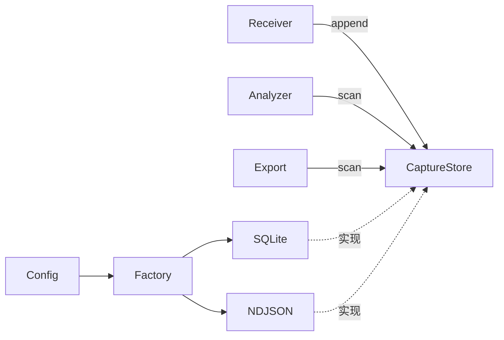

<!-- 本文件定义采集存储抽象、后端职责和读取边界。 -->
# 采集存储架构

`actrail-kv-storage` 使用 `CapturedRequest`，定义对象安全的异步 `append` 和带 `CaptureFilter` 的 `scan`。扫描范围在打开时固定，匹配记录逐条返回。Receiver 在追加完成后返回 202。Analyzer 的托管语料入口和历史文件入口共用语料校验与分析核心。历史文件采用原有宽松解析，记录物理行号，并将未知字段纳入请求 ID。

SQLite 使用 WAL、只读扫描事务和有界游标。每行保存完整记录与独立索引字段，索引为 `(session_key, captured_at)` 和 `(captured_at)`。索引时间键规范化为纳秒精度的 UTC 文本，完整记录保留原有时间表示。保留期维护分批删除到期行。容量计数表通过触发器维护记录 JSON 的 UTF-8 字节总量，旧数据库首次打开时回填计数。容量淘汰按 `(captured_at, id)` 顺序执行，与新记录写入处于同一个立即写事务。

托管 NDJSON 使用目录存储。分片名称编码 UTC 窗口、分片序号和唯一标识，默认窗口为一小时，默认大小上限为 64 MiB。单条记录超过分段大小上限时独占一个分片，但仍受总容量约束。容量回收在写锁内按最旧分段执行。读者记录各分片的已提交长度，并逐个读取固定范围。追加与快照边界确定由同一把短期跨进程锁协调。分片所属时间窗口整个到期后可回收，新扫描直接排除已过期记录。已建立的扫描若遇到尚待读取的分片被回收，会返回快照失效错误。

[存储配置](../../configuration.md#采集存储)通过 `storage.backend` 选择后端。`storage.retention` 提供默认 7 天保留期限和 256 MiB 容量上限，后端可在 `storage.backends.<backend>.retention` 覆盖期限并设置独立的清理参数。工厂根据选中的后端及其生效配置构造实例。只读实例按配置处理筛选和到期可见性，可写实例周期清理。导出命令通过 `scan` 取得记录并原子发布 NDJSON。

SQLite 容量按保留 JSON 字节计量，NDJSON 按托管分段文件总字节计量。可写实例打开时和写入前执行容量回收，关闭时间清理不会关闭容量约束。SQLite 的索引、空闲页和 WAL 不计入逻辑数据容量。
