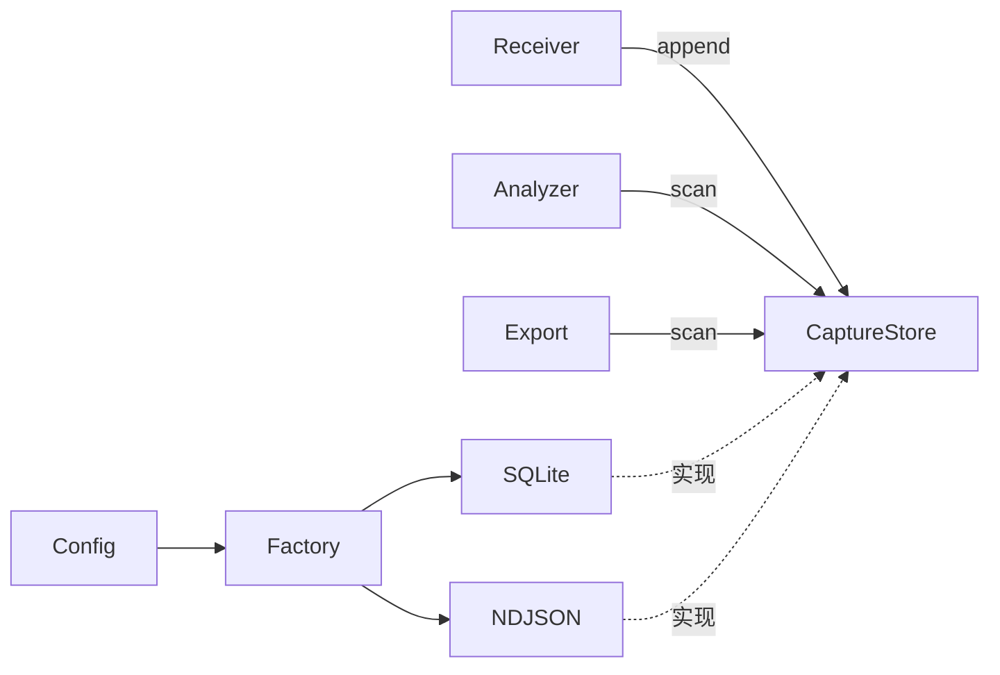

<!-- 本文件定义采集存储抽象、后端职责和读取边界。 -->
# 采集存储架构

`actrail-kv-storage` 使用 `CapturedRequest`，定义对象安全的异步 `append` 和带 `CaptureFilter` 的 `scan`。扫描范围在打开时固定，匹配记录逐条返回。Receiver 在追加完成后返回 202。Analyzer 的托管语料入口和历史文件入口共用语料校验与分析核心。历史文件采用原有宽松解析，记录物理行号，并将未知字段纳入请求 ID。

SQLite 使用 WAL、只读扫描事务和有界游标。每行保存完整记录与独立索引字段，索引为 `(session_key, captured_at)` 和 `(captured_at)`。索引时间键规范化为纳秒精度的 UTC 文本，完整记录保留原有时间表示。保留期维护分批删除到期行。

托管 NDJSON 使用目录存储。分片名称编码 UTC 窗口、分片序号和唯一标识，默认窗口为一小时，默认大小上限为 64 MiB。单条记录超过大小上限时独占一个分片。读者记录各分片的已提交长度，并逐个读取固定范围。追加与快照边界确定由同一把短期跨进程锁协调。分片所属时间窗口整个到期后可回收，新扫描直接排除已过期记录。已建立的扫描若遇到尚待读取的分片被回收，会返回快照失效错误。

[存储配置](../../configuration.md#采集存储)通过 `storage.backend` 选择后端。工厂根据选中的 `storage.backends.<backend>` 参数构造实例。只读实例按配置处理筛选和到期可见性，可写实例周期清理。导出命令通过 `scan` 取得记录并原子发布 NDJSON。
