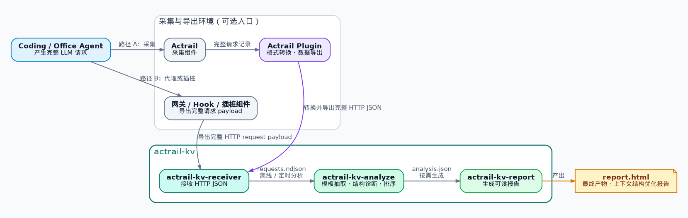

<!-- 本文件记录 AcTrail 作为观测侧供给方的接入边界。 -->
# AcTrail 接入

[AcTrail](https://gitcode.com/openeuler/AcTrail) 收集观测数据。供给方从观测记录提取完整模型请求并按 [Receiver HTTP 协议](../../reference/receiver/input.md)上报。AcTrail 的观测与导出配置由其项目维护。

[接入图源文件](deployment-view.puml)展示面向 AcTrail 的部署示例。
